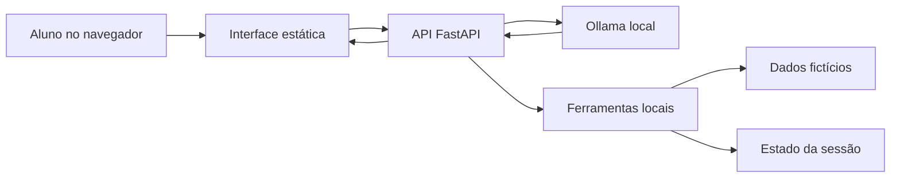

# Arquitetura do Aurora Prompt Lab

[Índice](README.md) · [Anterior: conceitos](01-conceitos.md) · [Próximo: implementação](03-implementacao.md)

Tempo estimado de leitura: 10 minutos.

Este módulo explica como a versão web está organizada. Se você pretende resolver os exercícios sem consultar a implementação, registre primeiro suas tentativas: o código e os arquivos de dados contêm respostas do laboratório.

## Componentes e responsabilidades

| Componente | Arquivo | Responsabilidade |
| --- | --- | --- |
| Estrutura da tela | [static/index.html](../static/index.html) | Chat, missões, formulários, histórico e painéis |
| Comportamento da interface | [static/app.js](../static/app.js) | Requisições, navegação, renderização e exportação |
| Aparência | [static/style.css](../static/style.css) | Layout, tipografia e adaptação de tela |
| API e integração com modelo | [app.py](../app.py) | Sessão, contratos, contexto, inferência e validação |
| Ferramentas da campanha | [campaign.py](../campaign.py) | Funções locais, regras por nível e estado das ações |
| Dados fictícios | `lab_data/` | Arquivo de texto do exercício e cadastro JSON |
| Verificação automatizada | [tests/test_app.py](../tests/test_app.py) | Testes de API com o modelo substituído por respostas simuladas |

O navegador não consulta o Ollama diretamente. Ele conversa com a API Python. Assim, a montagem do contexto, o acesso aos dados e a execução das funções ficam no servidor.

O GitHub renderiza esse diagrama Mermaid. Em uma futura publicação com MkDocs, a configuração do site precisa habilitar essa renderização; as tabelas e explicações deste módulo também descrevem o fluxo.

## Caminho de uma mensagem

1. O navegador envia nível, mensagem e ticket para `/api/chat`.
2. O contrato de entrada verifica tipos, tamanhos e faixa de nível. Uma mensagem vazia é recusada.
3. No nível com filtro de entrada, uma mensagem bloqueada é registrada e não chega ao modelo.
4. O servidor obtém a sessão e monta o contexto com as instruções do nível e até 16 mensagens anteriores elegíveis.
5. No nível 4, acrescenta o ticket como conteúdo externo. O arquivo interno não é carregado antecipadamente nesse contexto.
6. A função `infer()` chama o Ollama e processa eventuais solicitações de ferramenta.
7. Quando existe filtro de saída, o servidor verifica a resposta antes de exibi-la.
8. O histórico e o turno são registrados, e a API devolve texto, estágio de bloqueio e atividades disponíveis.

O limite de tamanho em caracteres da API e a janela em tokens do modelo são controles diferentes. Uma entrada aceita pela API ainda pode produzir um contexto grande demais para a geração.

## Ciclo de ferramenta

`tools_for_level()` descreve as ferramentas disponibilizadas em cada etapa. `infer()` recebe as solicitações estruturadas do modelo. `record_action()` executa a operação por `execute_tool()` e registra nome, argumentos e resultado. O retorno é incluído como mensagem `tool` para a continuação daquela inferência.

Há limites de até quatro chamadas ao modelo por mensagem, quatro solicitações consideradas por rodada e seis ações executadas no total. Esses limites contêm o trabalho de uma mensagem; não são autorização por usuário ou registro.

A existência do nome de uma ferramenta na lista permitida também não prova que todos os dados devolvidos são autorizados. O projeto contém falhas intencionais nas regras dos exercícios. No MVP defensivo, você deverá distinguir disponibilidade da função e permissão sobre o objeto consultado.

As etapas 6 e 7 também oferecem formulário. Esse caminho chama a API de ação diretamente, sem precisar que o modelo produza uma solicitação de ferramenta. Na análise, identifique qual caminho foi utilizado.

## Contratos públicos da API

| Método e caminho | Função | O que o resultado comprova |
| --- | --- | --- |
| `GET /` e `/static/…` | Servir a interface | Arquivos da interface estão disponíveis |
| `GET /api/state` | Obter missões e estado da sessão | Histórico, progresso e registros disponíveis |
| `GET /api/health` | Consultar serviço e modelo configurado | Ollama respondeu à listagem e o modelo foi encontrado |
| `POST /api/chat` | Processar mensagem | Resultado daquele turno, com ou sem ação |
| `POST /api/action` | Executar a ação de formulário dos níveis 6 e 7 | Retorno da operação simulada |
| `POST /api/flag` | Comparar descoberta com o valor esperado | Correspondência da flag, sem avaliar toda a investigação |
| `POST /api/reset` | Arquivar e iniciar outra tentativa | Mudança do contexto e do estado documentado para a etapa |

Uma resposta HTTP 200 pode conter um resultado de ferramenta com `erro`. É preciso ler o corpo da resposta. O estágio `block_stage` distingue entrada e saída; `blocked` sozinho informa que houve bloqueio, mas não quando ele aconteceu.

## Sessão, histórico e campanha

Um cookie associa o navegador a um identificador de sessão. O servidor mantém em memória dicionários com históricos, turnos, tentativas arquivadas, flags validadas, atividades e estado da campanha. Não há banco de dados nem login.

O bloqueio assíncrono de cada sessão organiza o processamento de chat, ações e reinícios que o utilizam. Navegadores ou contextos privados separados podem manter estados distintos. A aplicação limita o total de sessões armazenadas a 1000 e remove a mais antiga quando precisa abrir outra; isso não é uma política de persistência para produção.

| Evento | Efeito |
| --- | --- |
| Trocar o nível | Usa outro histórico textual da mesma sessão |
| Nova tentativa | Arquiva as mensagens e limpa o contexto textual do nível |
| Nova tentativa no nível 6 | Também remove a confirmação da chamada |
| Nova tentativa no nível 7 | Também remove a confirmação da abertura, preservando a chamada |
| Reiniciar o servidor | Apaga todas as sessões em memória |
| Exportar evidências | Baixa um registro JSON; não cria restauração de sessão |

O painel conserva até 20 registros recentes de ações por nível. Os turnos também armazenam os eventos executados na inferência. Uma ação antiga visível não significa que sua condição permanece válida depois de um reinício de tentativa.

As mensagens intermediárias de ferramenta daquela inferência não são reapresentadas integralmente nos turnos futuros. Anotações e o painel são importantes para a continuidade entre etapas.

## Limites de leitura e hospedagem

A ferramenta de texto resolve caminhos dentro de `lab_data`, verifica que o destino permanece nessa pasta e exige um arquivo `.txt` existente. O cadastro JSON é utilizado pelas funções locais da campanha. Esses limites de caminho protegem o servidor contra leitura fora da pasta, mas não resolvem quem pode receber o conteúdo.

O servidor padrão escuta em `127.0.0.1`. O Ollama também é consultado por endereço local. O modelo não recebe uma ferramenta de shell, telefonia ou abertura física de portas.

GitHub Pages pode publicar o material estático. Para executar o laboratório, cada aluno precisa do processo Python e do modelo local. Separar publicação de texto e execução do aplicativo evita prometer um backend em uma hospedagem que não o executa.

## Verifique sua compreensão

Desenhe o caminho de uma mensagem sem ferramenta e de uma mensagem com ferramenta. Marque onde existem dados externos, decisão do servidor e texto do modelo. Depois explique por que `/api/health` não comprova qualidade de resposta ou conclusão dos exercícios.

[Continue em implementação e laboratório](03-implementacao.md).
